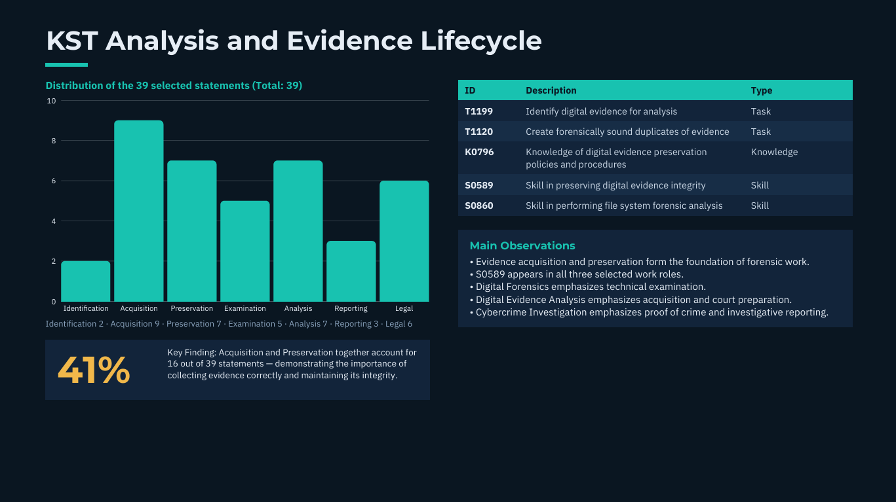

# Activity 1: Digital Forensics Workforce Analysis Based on NICE

  <strong>Cybersecurity | Digital Forensics | Workforce Analysis</strong>

## Project Overview

This academic research project analyzes the Digital Forensics workforce using the NICE Workforce Framework for Cybersecurity.

The project explores how NICE Work Roles define the professional responsibilities, knowledge, and technical skills required in digital forensics.

It identifies relevant work roles, analyzes their Knowledge, Skills, and Tasks (KST), develops competency mapping matrices, and evaluates professional competency gaps for an entry-level Digital Forensics practitioner.

**Main Objective:** To understand the competencies required in digital forensics and develop a structured professional development roadmap based on the NICE Framework.

---

## Project Scope & Methodology

The research followed these main stages:

1. Reviewed the NICE Workforce Framework and its components.
2. Identified relevant Digital Forensics work roles.
3. Selected and classified Knowledge, Skills, and Tasks.
4. Grouped KST statements according to forensic investigation phases.
5. Mapped competencies to practical forensic responsibilities.
6. Evaluated entry-level competency gaps.
7. Developed professional development recommendations.

**Framework:** NICE Framework Version 2.2.0  
**Main Reference:** NIST SP 800-181 Rev. 1

---

## Selected NICE Work Roles

Three core or closely related work roles were selected:

### 1. Digital Forensics (PD-WRL-002)
**Category:** Protection and Defense

Focuses on the technical examination of digital evidence, including forensic imaging, file-system analysis, memory examination, data recovery, and forensic reporting.

### 2. Digital Evidence Analysis (IN-WRL-002)
**Category:** Investigation

Focuses on identifying, collecting, examining, and preserving digital evidence through controlled and documented forensic procedures.

### 3. Cybercrime Investigation (IN-WRL-001)
**Category:** Investigation

Focuses on investigating cybercrime, identifying elements of proof, collecting evidence, identifying perpetrators, and preparing investigative reports.

### Adjacent Roles Examined

- Incident Response (PD-WRL-003)
- Insider Threat Analysis (PD-WRL-005)

These roles were reviewed but not selected as the three main roles because their primary responsibilities differ from the main focus of digital forensic examination.

---

## Key Results & Findings

### 1. Work Role Identification

- Identified three relevant NICE Work Roles across two categories.
- Examined two additional adjacent roles.
- Identified shared evidence-handling responsibilities across the selected roles.

### 2. KST Analysis

- Selected 15 KST statements per work role.
- Analyzed 39 unique KST statements after accounting for shared statements.
- Classified the statements across seven forensic phases.

### KST Distribution by Forensic Phase

| Forensic Phase | Statements |
|---|---:|
| Acquisition | 9 |
| Preservation | 7 |
| Analysis | 7 |
| Legal | 6 |
| Examination | 5 |
| Reporting | 3 |
| Identification | 2 |
| **Total** | **39** |

**Key Finding:** Acquisition and Preservation account for 16 of the 39 selected statements (41%). This highlights the importance of evidence collection, preservation, and integrity in digital forensic work.

### KST Analysis Visualization

The following visualization summarizes the distribution of the 39 selected KST statements across seven forensic phases.

  

**Key Insight:** Acquisition and Preservation account for 41% of the selected statements, highlighting the importance of evidence collection and integrity.

### 3. Shared Professional Competencies

The analysis identified evidence integrity as a cross-cutting competency shared by all three selected roles.

Important areas include:

- Digital evidence collection.
- Evidence preservation.
- Data integrity.
- Chain of Custody.
- Secure evidence handling.

### 4. Differences Between Work Roles

| Work Role | Main Professional Focus |
|---|---|
| Digital Forensics | Technical examination and analysis |
| Digital Evidence Analysis | Evidence lifecycle and acquisition |
| Cybercrime Investigation | Proof of crime and investigative reporting |

---

## Competency Gap Analysis

The project evaluated the competency levels required for an entry-level Digital Forensics practitioner.

### Main Gap Analysis Results

| Competency Area | Identified Gap |
|---|---|
| Forensic Imaging and Acquisition | Medium |
| Evidence Integrity and Chain of Custody | Low |
| File-System Analysis | Medium |
| Data Recovery and File Carving | Medium |
| Memory Forensics | Medium |
| Log Analysis | Medium |
| Reporting and Communication | Low to Medium |
| Legal and Court Procedures | High |
| Anti-Forensics Awareness | Low |

**Main Finding:** The largest identified gap was in legal and court-related competencies, followed by practical laboratory skills that require structured hands-on training.

*Note: These competency levels represent the report's author-assessed baseline assumptions for a student with theoretical knowledge and limited laboratory practice. They are not official NICE ratings.*

---

## Tools & Technologies Discussed

The report discusses practical tools and techniques that can support Digital Forensics training:

- **Autopsy:** Digital forensic examination and file-system analysis.
- **FTK Imager:** Forensic imaging and evidence acquisition.
- **Volatility:** Memory forensics.
- **Wireshark:** Network traffic analysis.
- **SHA-256:** Evidence integrity verification through hashing.
- **Write Blockers:** Protection of original digital evidence during acquisition.

These tools are discussed as practical examples and recommended training resources, not as a claim that every tool was used in a completed forensic investigation.

---

## Conclusions & Recommendations

The research demonstrates that Digital Forensics involves multiple professional roles with shared evidence-handling foundations but different technical and investigative responsibilities.

The main recommendations are:

1. **Build a Strong Technical Foundation:** Develop knowledge of operating systems, file systems, evidence handling, and Chain of Custody.
2. **Increase Practical Laboratory Experience:** Practice forensic imaging, file-system analysis, deleted-file recovery, memory analysis, and log analysis.
3. **Strengthen Legal Knowledge:** Study evidence admissibility, court procedures, and Egyptian Law No. 175 of 2018.
4. **Develop Professional Qualifications:** Consider Security+ and CySA+ as foundational certifications, followed by specialized certifications such as GCFE, GCFA, or CHFI.
5. **Continuous Professional Development:** Follow NICE Framework updates and continue developing technical and legal competencies.

---

## Project Deliverables

| Deliverable | Description |
|---|---|
| Technical Research Report | Full academic research and analysis |
| Research Presentation | Summary of the project and findings |
| KST Analysis | Selected Knowledge, Skills, and Tasks |
| Competency Mapping Matrix | Mapping KST statements to professional responsibilities |
| Gap Analysis | Assessment of entry-level competency gaps |
| Recommendations | Professional training and development roadmap |

---

## Project Documentation

Explore the full academic work:

- [Technical Research Report (PDF)](Activity-1-NICE-FrameworkReport.pdf)
- [Presentation](Presentation/)
- [Supporting Materials](Supporting-Materials/)

The complete report contains the detailed methodology, KST statements, competency matrices, gap analysis tables, conclusions, and references.

---

## References

1. Petersen, R., et al. (2020). NIST SP 800-181 Rev. 1 – Workforce Framework for Cybersecurity (NICE Framework).
2. National Institute of Standards and Technology (NIST). NICE Framework Resource Center, Version 2.2.0.
3. NIST Cybersecurity and Privacy Reference Tool (CPRT).
4. CISA / NICCS – NICE Framework Work Role Pages.
5. ISO/IEC 27037:2012 – Guidelines for Identification, Collection, Acquisition and Preservation of Digital Evidence.
6. Arab Republic of Egypt. Law No. 175 of 2018 on Combating Information Technology Crimes.
7. GIAC Certifications – GCFE and GCFA.
8. EC-Council – Computer Hacking Forensic Investigator (CHFI).

---

## Academic Information

**Project:** Activity 1 – Digital Forensics Workforce Analysis Based on NICE  
**Course:** Digital Forensics  
**University:** Egyptian Russian University (ERU)  
**Faculty:** Faculty of Artificial Intelligence  
**Department:** Cyber Security  
**Academic Year:** 2026

---

  <strong>End of Project Overview</strong> 
  Digital Forensics | Cybersecurity | NICE Workforce Framework

## Project Status

Completed – Academic Research Project

The research report, presentation, KST analysis,
competency mapping, and gap analysis have been
documented and organized in this repository.
